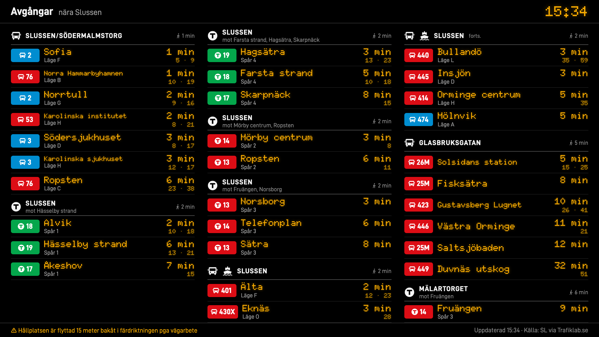

# Stockholm transport departure screen

A full-screen departure board for SL metro, commuter trains, trams, buses and boats near a chosen location in Stockholm. It is a single static page meant for a wall-mounted screen, and works on any static host.



This is an independent project. It is not made or endorsed by SL (Storstockholms Lokaltrafik) or Trafiklab.

## Files

- `stockholm-transport/index.html` is the whole site: markup, styles and script.
- `.claude/launch.json` is a preview configuration for Claude Code.

## Run locally

```bash
python3 -m http.server 8765 --directory stockholm-transport
```

Then open `http://localhost:8765/`.

## Data sources

The page is based on information retrieved from [Trafiklab.se](https://www.trafiklab.se/). Both APIs need no key and allow calls from a browser. Their use is covered by the [terms for SL APIs on Trafiklab](https://www.trafiklab.se/api/other-apis/sl/licence/), which require this attribution and ask users not to make excessive requests. The page footer shows the attribution; keep it if you change the page.

- SL Transport API, `https://transport.integration.sl.se/v1`: `/sites` and `/stop-points` for the stop list (cached in the browser for 24 hours), `/sites/{id}/departures` for departures.
- SL journey planner, `https://journeyplanner.integration.sl.se/v2/stop-finder`: address and stop search in the settings panel.

SL returns HTTP 429 when requests arrive too fast. The page asks for at most 12 stops per refresh, two at a time, retries a 429 twice and keeps the previous times for a stop that fails. The refresh interval is 30 to 60 seconds depending on the number of stops; the countdown is recalculated every second in between.

## Link parameters

Settings are stored in the URL fragment, so a link opens the board with the same location and settings. Example:

```
https://example.com/stockholm-transport/#lat=59.3196&lon=18.0722&name=Slussen&r=600&hide=boat&lang=en
```

| Parameter | Meaning | Default |
| --- | --- | --- |
| `lat`, `lon` | Location in decimal degrees | T-Centralen |
| `name` | Label shown in the header | The coordinates |
| `addr` | Address to look up instead of `lat` and `lon` | |
| `r` | Radius in metres | 500 |
| `hide` | Transport types to hide: `metro`, `train`, `tram`, `bus`, `boat` | none |
| `show` | Alternative to `hide`: the only types to show | all |
| `lang` | `sv` or `en` | `sv` |
| `win` | Show departures within this many minutes | 60 |
| `walk` | `0` also shows departures that leave before you can walk to the stop | on |
| `size` | Text size: `a` (automatic), `s`, `m`, `l` or `x` | `a` |
| `led` | `0` switches from the dot-matrix typeface to a plain one | on |
| `msg` | `0` hides disruption messages | on |

Keyboard: `S` opens settings, `F` toggles full screen.

## Follow my location

On a phone, tablet or laptop, "Följ min position" in the settings panel moves the board to the device's current position each time the page is opened or shown again (unlocking the phone, switching back to the tab or window). The page itself is not reloaded; only departures are fetched again.

- "Använd min position" turns following on. Choosing an address or stop, or opening a link to another place, turns it off.
- The setting is greyed out until the browser allows location access, and the page only reads the position when access is already allowed, so it never shows a permission prompt on its own. Safari forgets the permission after about a day if the site is set to "Ask"; tap "Använd min position" again to resume.
- Moves under 75 metres are ignored, and the position is read at most every 30 seconds.
- The setting is saved on the device and is not part of the link, so a shared link or a wall screen never follows anyone's location.

## Line colours

Colours are set in the `COL` table in `index.html`. Metro lines use their line colour, commuter trains pink, buses red or blue (blåbuss), and each tram and light rail line its own colour. Boats use a single teal that is not an SL colour.

## Layout rules

- Automatic text size picks the largest size at which every row fits, and never goes below a size readable from a distance. If rows still do not fit, those from the farthest stops are dropped first. The text shrinks at once when rows no longer fit, but only grows after the larger size has fitted for three minutes.
- Sections keep their columns between updates. The board is rearranged when a departure would stay hidden for more than a minute, when a tidier arrangement (no empty column, fewer split sections) has been possible for five minutes, or when the screen size, location or settings change.
- Walking time is the straight-line distance to the stop at 75 metres per minute. Departures that leave sooner than that are hidden.
- A line and destination served by several stops in range is shown for the nearest stop only.

## Privacy

- The page has no server of its own and no analytics. Settings and the stop list are saved in the browser's local storage.
- The browser sends stop ids and place searches to SL. The chosen coordinates are not sent; distances are calculated in the browser. The same applies to the device position when following is on.
- The dot-matrix typeface, [Doto](https://github.com/oliverlalan/Doto) (SIL Open Font License 1.1), is loaded from Google Fonts, so Google sees the visitor's IP address. To avoid that, host the font file yourself and change the stylesheet link in `index.html`.

## Deploy

Copy the `stockholm-transport` folder to any static web host. There is no build step.

## Licence

The code is released under the [MIT licence](LICENSE). The licence covers the code only. SL data is covered by the Trafiklab terms linked under Data sources, and the Doto typeface by the SIL Open Font License 1.1.
